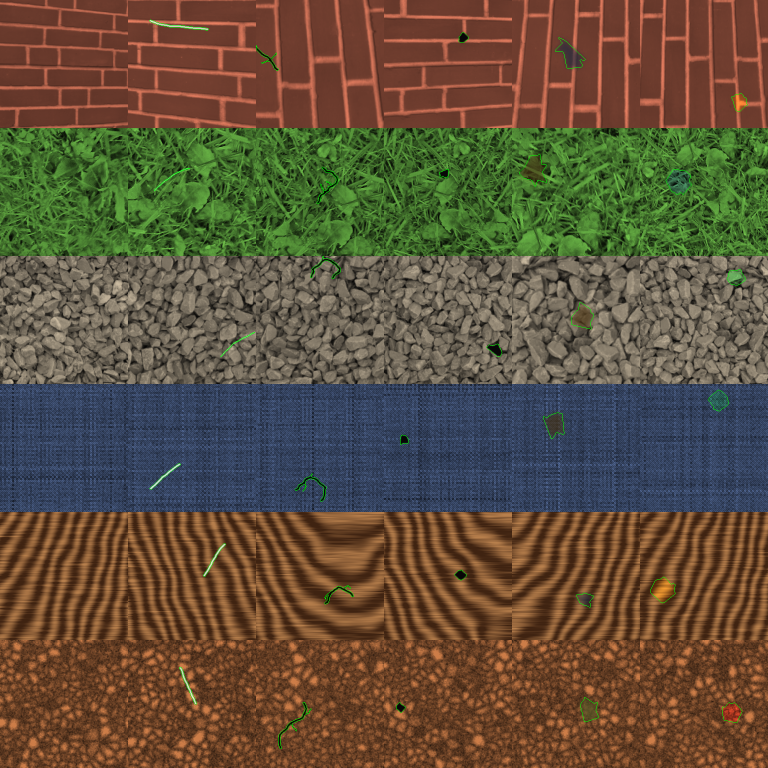
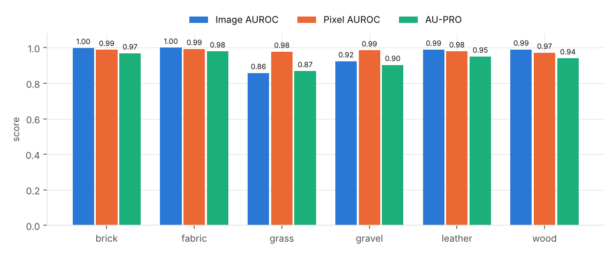
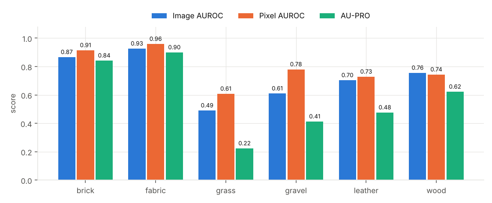
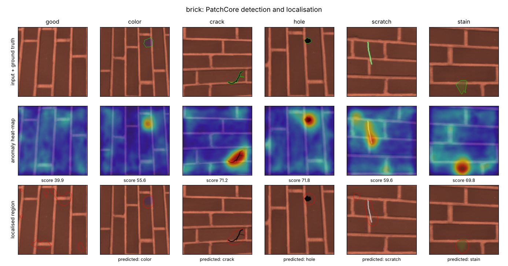
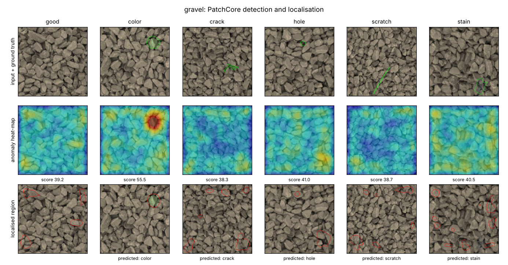
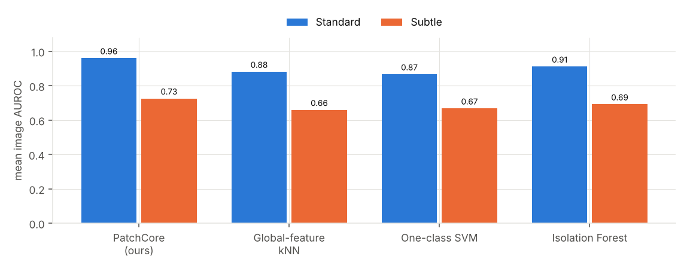
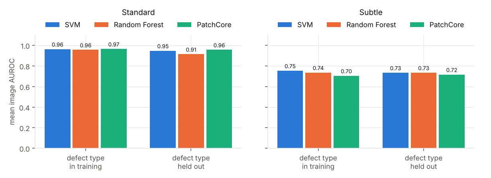
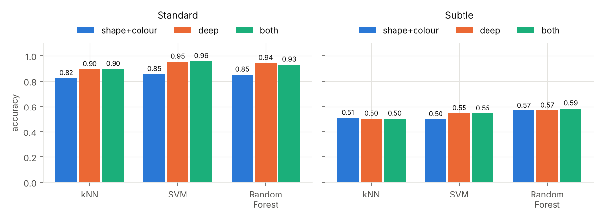
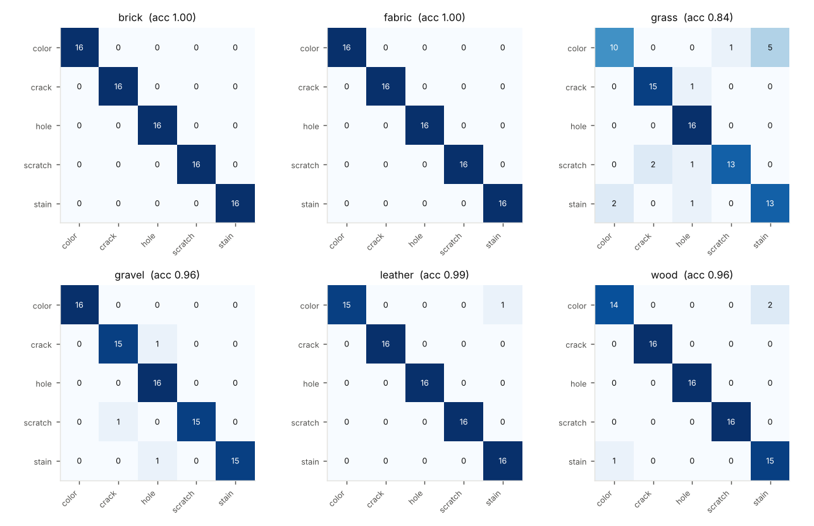
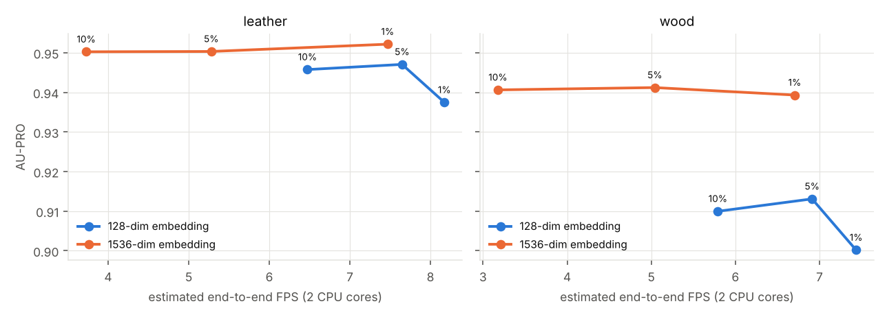

# Automatic surface-defect detection, localisation and identification without defect labels

*PatchCore on a CPU with ONNX Runtime, plus kNN / SVM / Random Forest for defect types*

## Status at a glance

| Item | Status |
|---|---|
| Method and software (detection, localisation, type identification, baselines, inference CLI) | **Done, tested end to end** |
| Pretrained CNN backbone (ImageNet WideResNet50-2) | **Done, verified** (classifies test photos correctly after conversion) |
| Results on the **synthetic stand-in datasets** (6 textures x 2 difficulty levels) | **Done** (Section 5) |
| Results on **MVTec AD** | **Not run.** The workspace could not reach the dataset (network policy). Code is ready; one command runs it (Section 7). |
| Results on **your team's own fabric / leather / wood photos** | **Not run.** The photos do not exist yet. The same command handles them (Section 7). |

Every number in this report was measured on the synthetic stand-in data. **They show that the pipeline works and how its parts compare; they are not MVTec AD results and must not be quoted as such.** For orientation only: the PatchCore paper reports image-level AUROC of up to 99.6 % on MVTec AD (Roth et al., CVPR 2022). That figure is from the literature, not from this project.

## 1. Problem and approach

Manual inspection is slow, tiring and inconsistent, and supervised classifiers need many labelled examples of every defect type, which factories rarely have because defects are rare and varied. The approach here removes that need:

1. **Detect** by learning what *normal* looks like. A pretrained CNN (transfer learning) turns every small patch of a defect-free image into a feature vector. Training stores a compact memory of normal patch vectors (PatchCore). A test patch that is far from every stored normal patch is anomalous. No defect image is needed, so a new kind of defect is detected like any other.
2. **Locate** by keeping the per-patch scores as an anomaly heat-map and outlining the strongest region.
3. **Identify the type** (only if a few labelled defects exist) by describing the located region with deep features and simple shape/colour measurements, then classifying it with kNN, SVM or Random Forest.
4. **Run cheaply**: CPU only, ONNX Runtime, no PyTorch, no GPU.

## 2. Method

**Backbone.** WideResNet50-2 pretrained on ImageNet (timm `wide_resnet50_racm`, SHA-256 checked). Layers 2 and 3 are used; each is smoothed with a 3x3 average, layer 3 is upsampled and the two are concatenated: 1536 numbers per 8x8-pixel patch. Input is 256x256 RGB.

**Memory bank.** All patches of the defect-free training images are embedded. A greedy k-center *coreset* keeps the 10 % most representative patches (selection runs on a 128-dim random projection for speed). About 15 % of the training images are held out of the bank and used only to set the decision threshold.

**Scoring.** A patch's score is its distance to the nearest memory patch. Image score = highest patch score. Heat-map = bilinear upsampling plus Gaussian smoothing. Decision threshold = mean + 3 standard deviations of the held-out good images' scores.

**Defect region and type.** The region is the part of the heat-map above the midpoint between background level (median) and peak. Descriptors: the mean deep embedding inside the region (reduced by PCA to 20 dimensions) and 18 shape/colour/contrast measurements (area, elongation, solidity, compactness, colour shift relative to the surroundings, texture change and others). kNN (k=3), RBF-SVM and Random Forest (300 trees) are compared, on shape+colour only, deep only, and both.

**Comparison methods.**
- *Unsupervised, image level* (same defect-free training images): global-feature kNN, one-class SVM, isolation forest, all on mean+max pooled backbone features.
- *Supervised good-vs-defect* SVM and Random Forest, to test the claim that models trained on known defect types fail on new ones.

## 3. Implementation notes

- **No PyTorch.** The checkpoint is read with a restricted unpickler (only a few harmless classes allowed, so a booby-trapped file cannot run code); BatchNorm is folded into the convolutions and the network is written as an ONNX graph by a small hand-written encoder (`sdd/onnx_min.py`). After conversion, the full network classifies a cat photo as "Egyptian cat" (72 %) and a coffee photo as "espresso" (88 %), which exercises every layer.
- **Library**: `sdd/` (backbone, PatchCore, classifiers, metrics, data, synthetic data, figures). **Scripts**: build backbone, run experiments, ablation, aggregate, fit a model from your own photos, fit a type classifier, inspect new images.
- **Metrics code checked on known cases** (perfect map gives 1.0, random map gives the expected 0.5 pixel AUROC and about 0.15 AU-PRO, half-covered regions give about 0.58).

## 4. Experimental setup

**Datasets (stand-in, synthetic).** Six categories in MVTec AD folder layout: three real textures from scikit-image (brick, grass, gravel; tinted to RGB) and three procedural ones (fabric, wood, leather). Per category: 100 defect-free training images, 40 defect-free test images, and 16 test images for each of 5 defect types (scratch, crack, hole, stain, colour fault) with pixel-accurate masks. Two difficulty levels with identical layouts: **Standard** (full-contrast defects) and **Subtle** (defect contrast scaled to 35 %, chosen in advance, not tuned). For the real textures, training and test crops come from different regions of the source photo, so no patch is shared.

**Metrics.** Image AUROC (good vs defective, threshold-free), pixel AUROC, and AU-PRO (per-region overlap for false-positive rates up to 0.3, the MVTec definition). F1/FPR/recall at the calibrated threshold are also given but should be read carefully (Section 5.7).

**Protocols.** Defect-type identification: stratified 5-fold cross-validation on the defective test images, per category. Unseen-defect test: for each defect type, supervised models train on defect-free images plus the *other* four types and are tested on the held-out type; "seen" trains on half of every type. Besides the training images, the supervised models also receive half of the test-good images as negatives (the other half is what everything is scored on, PatchCore included), so they are not handicapped by the region shift described in 5.7. All runs use seed 0.

## 5. Results

### 5.1 Detection and localisation

| Dataset | Image AUROC | Pixel AUROC | AU-PRO |
|---|---|---|---|
| Standard (mean of 6) | **0.960** | **0.983** | **0.935** |
| Subtle (mean of 6) | 0.725 | 0.789 | 0.580 |

On the Standard set, brick, fabric, leather and wood are essentially solved (image AUROC 0.989-1.000); gravel (0.924) and grass (0.858) are harder because their natural clutter resembles defects. Pixel AUROC stays high (0.97-0.99) even there, so the heat-maps are right more often than the single image-level score suggests.

**Subtle defects are where it breaks.** At 35 % contrast the mean image AUROC falls to 0.725, and grass (0.490) is at chance. Grass and gravel at 35 % contrast are close to invisible even in the ground-truth overlays. This is a real limit of the method on this data and is shown here rather than hidden.

Qualitative figures for every category and both levels are in `results/standin/` and `results/standin_subtle/`. **In those figures the "predicted" type comes from a classifier fitted on all defects, so it is in-sample; the honest accuracy is the cross-validated one in 5.5.**

### 5.2 Which defects are found

Per-type image AUROC tables for both datasets are in `results/report/summary.md`. On the Standard set the weakest cases are gravel hole (0.736) and crack (0.883) and grass crack (0.781). Averaged over categories, Standard AUROC is 0.93-0.98 for every defect type (hole lowest at 0.929, colour highest at 0.984). On Subtle, scratches are found most reliably (mean 0.849) and stains least (0.605); cracks are found well on brick, fabric and wood (0.98-1.00) but missed on grass and gravel (0.35-0.38).

### 5.3 Versus other unsupervised methods

Mean image AUROC, all trained on the same defect-free images:

| Dataset | PatchCore | Global-feature kNN | One-class SVM | Isolation Forest |
|---|---|---|---|---|
| Standard | **0.960** | 0.881 | 0.866 | 0.911 |
| Subtle | **0.725** | 0.659 | 0.667 | 0.692 |

Patch-level comparison beats one summary vector per image on both datasets, by 5-9 AUROC points on Standard. The reason is that a small defect barely moves a whole-image summary but is clearly far from every normal patch.

### 5.4 New defect types: supervised models versus PatchCore

| Dataset | Scenario | SVM (supervised) | Random Forest (supervised) | PatchCore (no defect labels) |
|---|---|---|---|---|
| Standard | defect type seen in training | 0.964 | 0.956 | 0.965 |
| Standard | defect type **held out** | 0.948 | 0.914 | **0.957** |
| Subtle | defect type seen in training | **0.754** | 0.736 | 0.704 |
| Subtle | defect type **held out** | 0.734 | 0.735 | 0.716 |

The problem statement's concern is real but **modest on this data**: when a type is held out, the supervised Random Forest loses 4 AUROC points and the SVM 2 on Standard, while PatchCore, which never saw any defect, loses less than 1. On Subtle there is no clear PatchCore advantage, and the supervised SVM is slightly better when it has seen the defect type. Two caveats keep this from being generalised: the five synthetic defect types are all "local oddities" and so transfer well to each other, and the supervised models were given 40-64 labelled defects, far more than a factory typically has. The firm conclusion is that PatchCore matches supervised models **without needing any defect label at all**; it does not decisively beat a well-fed supervised model.

### 5.5 Identifying the defect type

Cross-validated accuracy on defective images, mean over categories (chance = 0.20):

| Dataset | Features | kNN | SVM | Random Forest |
|---|---|---|---|---|
| Standard | shape + colour only | 0.823 | 0.854 | 0.850 |
| Standard | deep features only | 0.896 | 0.954 | 0.944 |
| Standard | both | 0.898 | **0.958** | 0.931 |
| Subtle | both | 0.502 | 0.546 | 0.585 |

On Standard defects the SVM identifies the type about 96 % of the time, and deep features carry most of the signal (the hand-made shape/colour measurements alone reach 85 %). Remaining errors are mostly colour fault vs stain, two soft-edged tinted blobs, which is a sensible confusion. On Subtle defects accuracy falls to 50-59 % because the localised region is often not the defect. **Type identification is only as good as localisation.** Categories have 16 examples per type, so each accuracy is estimated from roughly 80 images and moves by several points with a different split.

### 5.6 Speed and cost

Default configuration (1536-dim embedding, 10 % coreset), measured per image on **2 CPU cores, no GPU**: about **340 ms per image (2.9 FPS)** including reading the file. A second experiment varied memory-bank size and embedding dimension:

| Setting (1536-dim embedding) | Standard leather | Standard wood | Subtle fabric | Subtle wood |
|---|---|---|---|---|
| 10 % bank: AU-PRO / est. FPS | 0.950 / 3.7 | 0.941 / 3.2 | 0.900 / 4.0 | 0.623 / 4.0 |
| 1 % bank: AU-PRO / est. FPS | 0.952 / 7.5 | 0.939 / 6.7 | 0.894 / 7.7 | 0.620 / 8.1 |

A 1 % memory bank doubles the speed with AU-PRO within 0.006; image AUROC drops 0-3 points (largest on subtle wood, 0.756 to 0.725). Reducing the embedding to 128 dimensions with PCA was **not** a free win: it cost 4-6.5 AUROC points on wood. At 1 % the cost is dominated by the CNN itself (115-128 ms of roughly 135 ms per image), so further gains need a lighter backbone or smaller input, which was not tested. **Whether 7-8 FPS counts as "real time" depends on line speed** (a hundred items a minute is fine; a fast web inspection line is not). No GPU timing was possible here.

### 5.7 Thresholds: a limitation to read carefully

AUROC does not need a threshold; a deployed system does. At the calibrated threshold, Standard results average F1 0.907, recall 0.913 and false-positive rate 0.192, but with large differences per category (false positives of 77 % on grass, 30 % on brick, 0 % on gravel/leather/wood). I traced this to the data design: held-out *training-region* good images score 34.3 ± 1.8 on grass while good *test-region* images score 41.4 ± 2.4, so the threshold sits below most good test images. In MVTec AD, train and test good images come from the same process, so this shift should be far smaller, but it shows the threshold is fragile with 15 calibration images. **In practice, calibrate on at least 50-100 held-out good images from the real production line, and re-check after any change in lighting or material.**

F1 is also misleading here: two-thirds of the test images are defective, so flagging everything already scores F1 = 0.80. That is why the "best F1" column in `results/report/summary.md` is near 0.8 even where AUROC is near 0.5. Rely on AUROC and AU-PRO.

## 6. Discussion and limitations

- **No real-world evidence yet.** Synthetic defects are painted on textures; real defects are messier and class-specific. Results here establish method behaviour and software correctness only.
- **Hard cases are clear.** Low-contrast defects on cluttered natural textures (grass, gravel) are missed. Nothing in this project fixes that; higher input resolution, a larger memory bank or better lighting are the likely levers, untested here.
- **Borders.** Scores rise slightly at image edges (visible in the heat-maps), which can create false alarms there.
- **Backbone differs from the paper.** The ImageNet weights are timm's WideResNet50-2 recipe (the only pretrained WideResNet reachable offline), not the torchvision checkpoint used in the PatchCore paper. Input size is 256, no patch re-weighting, k=1. Expect numbers on MVTec AD to differ from published ones.
- **Type identification** needs a handful of labelled defects per type and depends on good localisation; with fewer than about 10 per type, treat the predicted type as a suggestion for a human.
- **Statistical weight.** One seed, 16 examples per defect type, no confidence intervals.

## 7. Completing the project on real data

1. Download MVTec AD (non-commercial licence) and run the two commands in `README.md`. Categories named in the problem statement: carpet, leather, wood, tile, grid. About 3-15 minutes per category on 2 cores.
2. Photograph your fabric, leather and wood with a fixed camera and lighting: 30-200 defect-free photos per material for `train/good`, further good photos for `test/good`, and defective photos in one folder per defect type. Run the same command, or use `scripts/fit_model.py` and `scripts/infer.py` for direct inspection. In a trial with only 30 good photos and 10 per defect type (stand-in wood), the detector worked and type accuracy was 0.82-0.88.
3. Replace Section 5 with those numbers. The report tables and figures are produced by `scripts/aggregate.py`.

## 8. References

- Roth, Pemula, Zepeda, Schölkopf, Brox, Gehler. *Towards Total Recall in Industrial Anomaly Detection.* CVPR 2022 (arXiv 2106.08265).
- Bergmann, Fauser, Sattlegger, Steger. *MVTec AD: A Comprehensive Real-World Dataset for Unsupervised Anomaly Detection.* CVPR 2019.
- Zagoruyko, Komodakis. *Wide Residual Networks.* BMVC 2016.
- Wightman. *PyTorch Image Models (timm)*, source of the pretrained weights.

## Appendix: full result tables

See `results/report/summary.md` (per category: all metrics, per-defect-type AUROC, ablation) and `results/standin*/<category>.json` (raw numbers).
